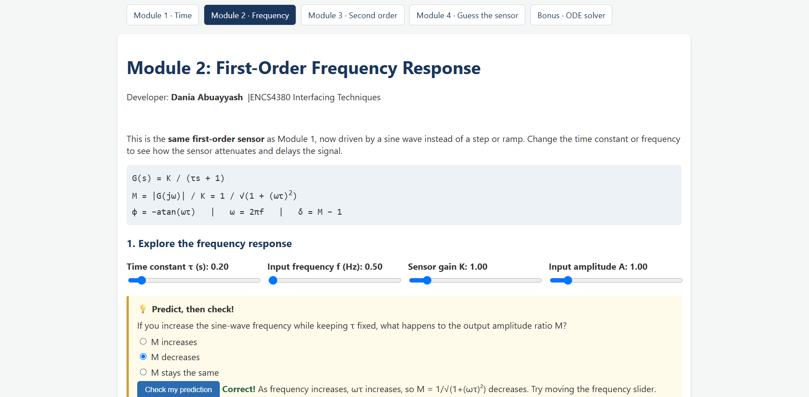
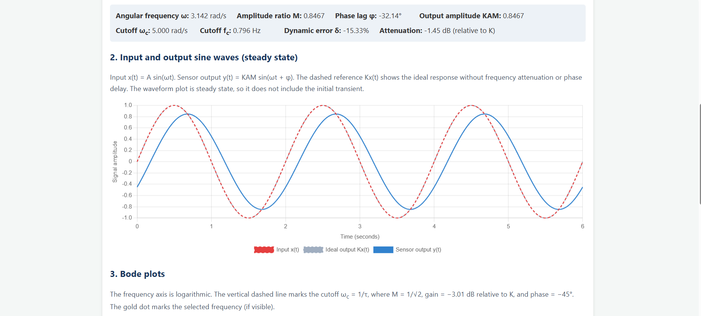
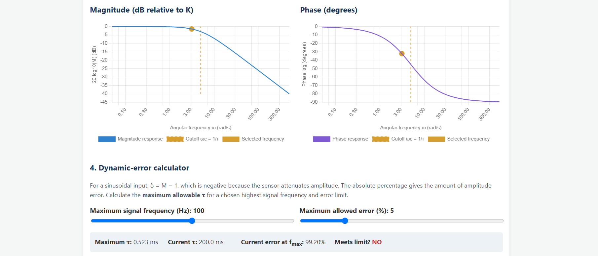
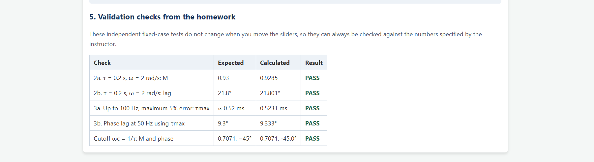
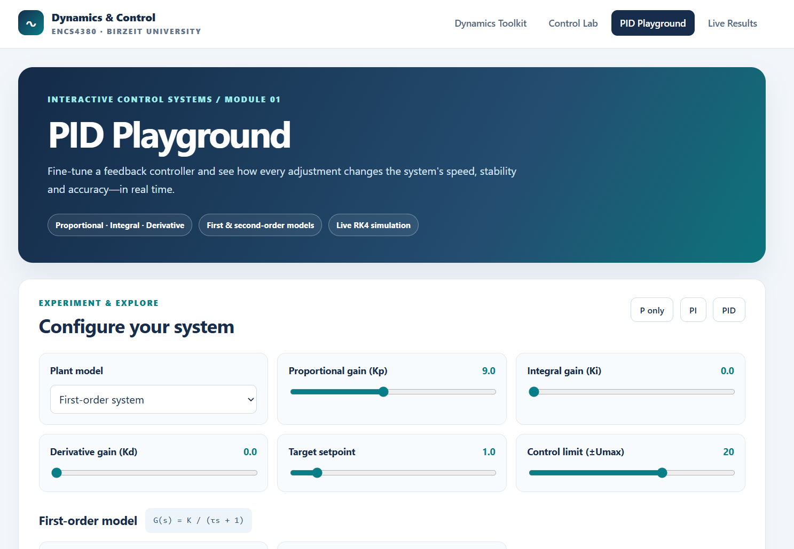
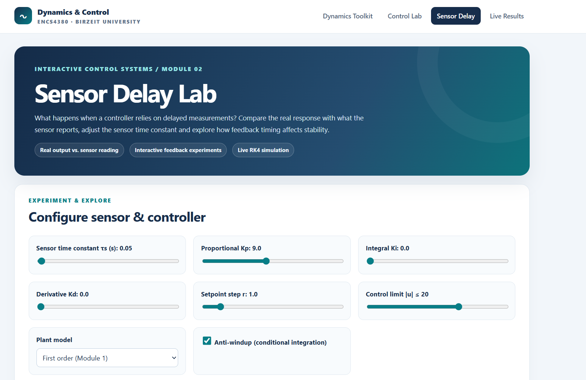
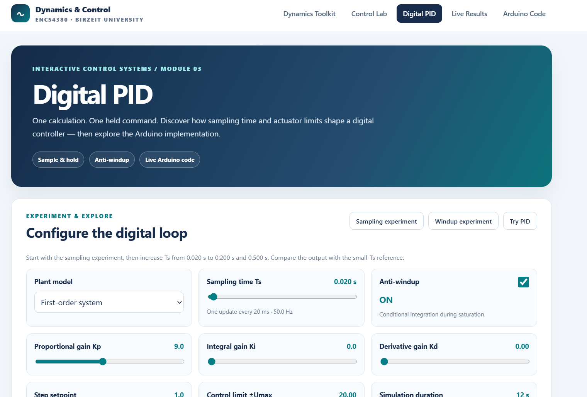
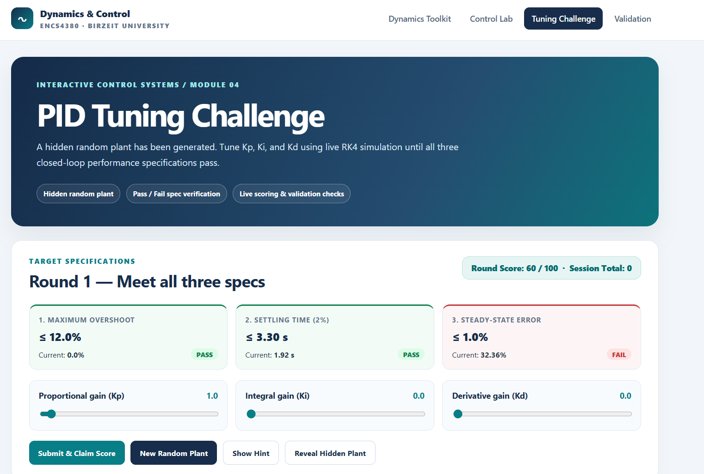
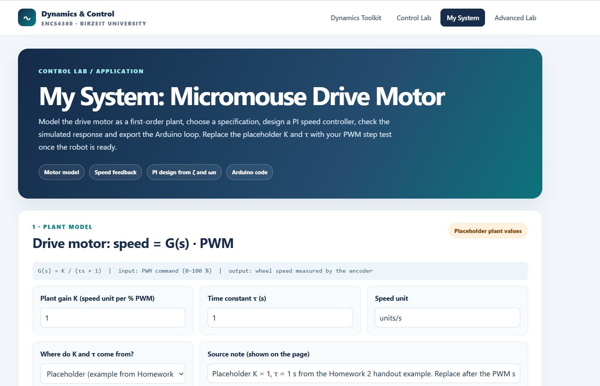
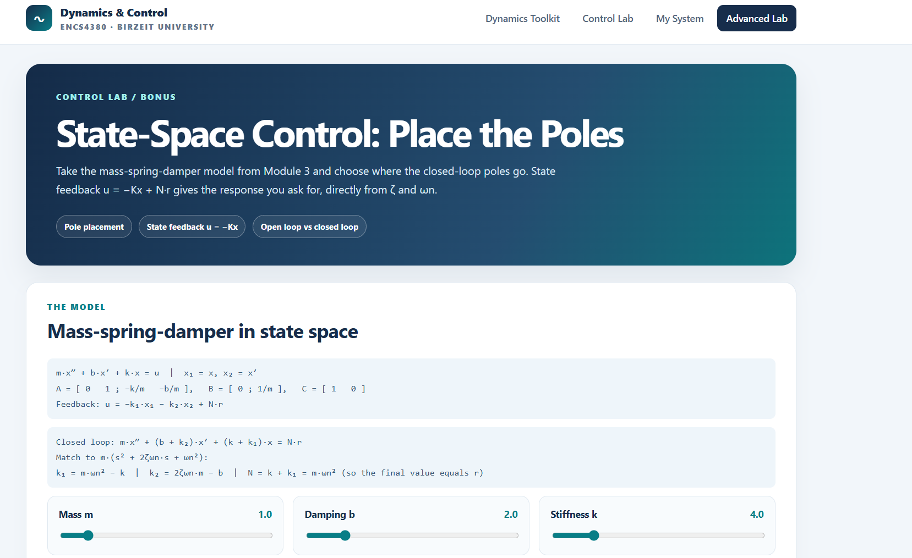

# ENCS4380: Dynamics and PID Control Toolkit

An interactive web project for **ENCS4380 Interfacing Techniques**, Birzeit University, supervised by **Dr. Wasel Ghanem**.

The toolkit combines **Homework 1: Dynamic Characteristics** and **Homework 2: PID Control** in the same repository. It helps users explore sensor responses, feedback, controller tuning, and digital implementation through live simulations.

**Live site:** https://sereen-karakra.github.io/encs4380-dynamics-42/

**Control Lab:** https://sereen-karakra.github.io/encs4380-dynamics-42/control.html

## Team

| Member | Homework 1 | Homework 2 |
|---|---|---|
| Dania Abu Ayyash | Module 2: First-order frequency response | P1: PID Playground and simulation engine |
| Sereen Karakra | Module 3: Second-order response | P2: Slow sensor in the feedback loop |
| Raneem Khawaja | Module 4: Guess the Sensor | P3: Digital PID |
| Maysam Abu Eid | Module 1: First-order time response | P4: Tuning Challenge and validation checks |
| Masa Awad | Bonus: Euler and RK4 solver comparison | My System, project integration, and submission documentation |

## How to Open the Project

- Open the live site to start the Dynamic Characteristics Toolkit.
- Select **Control Lab** to open the PID modules, motor application, and advanced control experiment.
- Inside a control module, use **Control Lab** to return or **Dynamics Toolkit** to open Homework 1.

For local testing, open the project folder in VS Code and run **Live Server**. Alternatively, run this command in the repository root:

```bash
python -m http.server 8000
```

Then open `http://localhost:8000/`.

The project is a static website; no backend, database, or account is needed. Most pages load Chart.js from a CDN, so an internet connection is needed for those plots. P3 draws its plots directly with SVG.

When pages are opened directly as local files, Control Lab links to P1–P4 are available. Its automatic checks for the motor and advanced pages require HTTP hosting, such as Live Server or GitHub Pages; those pages can also be opened directly by filename.

## Homework 1: Dynamic Characteristics

### Module 1 — First-Order Time Response

**File:** `index.html` · **Owner:** Maysam Abu Eid

Models a thermometer using `τ·dy/dt + y = K·x(t)`.

- Adjustable gain K, time constant τ, input amplitude/ramp rate, and step or ramp input.
- Live input, ideal-output, and sensor-output curves.
- Step markers at t = τ and t = 3τ, showing approximately 63.2% and 95% of the final value.
- Ramp lag, tracking error relative to the ideal output, and a log-error plot with theoretical slope −1/τ.
- Prediction question and reference validation table.

### Module 2 — First-Order Frequency Response

**File:** `module2.html` · **Owner:** Dania Abu Ayyash

- Adjustable τ, frequency, gain, and amplitude.
- Steady-state sinusoidal input/output plots.
- Amplitude ratio, phase lag, output amplitude, and signed dynamic error.
- Bode magnitude and phase plots with the cutoff frequency marked.
- Maximum allowable time-constant calculator, prediction question, and reference checks.

The sine plot shows the steady-state response and intentionally omits the startup transient.

### Module 3 — Second-Order Response

**File:** `module3.html` · **Owner:** Sereen Karakra

Uses the mass–spring–damper model `m·x'' + b·x' + k·x = F`.

- Adjustable mass, damping, stiffness, and step force.
- Natural frequency, damping ratio, damping classification, DC gain, and final displacement.
- Step response, rise time, peak time, overshoot, and settling time.
- Pole plot, state-space representation, and an RK4 phase-plane trajectory.
- Prediction question and validation checks.

### Module 4 — Guess the Sensor

**File:** `module4.html` · **Owner:** Raneem Khawaja

- Random first-order or underdamped second-order sensors, with small measurement noise.
- Step or steady-state sine inputs for first-order challenges; step inputs for second-order challenges.
- Users estimate τ, or ζ and ωn, before revealing the true parameters.
- Full marks require every estimated parameter to be within 10% of its true value.
- One submitted guess per sensor, hints, new challenges, and a session score stored in `sessionStorage`.

### Bonus — Own ODE Solver

**File:** `bonus.html` · **Owner:** Masa Awad

Compares our Euler and RK4 implementations with the exact first-order step response.

- Adjustable K, τ, input amplitude, and integration step h.
- Exact and numerical response curves, error plots, and maximum-error metrics.
- A prediction question about halving h and the convergence orders of Euler and RK4.

## Homework 2: PID Control

**Landing page:** `control.html`

The control modules reuse the first-order and second-order models from Homework 1. Closed-loop responses are calculated using our own numerical integration. Every core module includes **“Predict, then check”** interaction.

### P1 — PID Playground

**File:** `pid-playground.html` · **Owner:** Dania Abu Ayyash

- First-order and second-order plant selection.
- Adjustable Kp, Ki, Kd, setpoint, plant parameters, and control limit.
- Feedback-loop block diagram, output-versus-setpoint plot, and control-signal plot with limits.
- Rise time, overshoot, settling time, and estimated steady-state error.
- P-only, PI, and PID presets with reference checks.

P1 uses RK4 integration and takes derivative action from the measured output to avoid a setpoint kick.

### P2 — Slow Sensor in the Loop

**File:** `slow-sensor.html` · **Owner:** Sereen Karakra

- A first-order sensor in the feedback path, with adjustable time constant τs.
- Adjustable PID gains, plant parameters, setpoint, and actuator limit.
- True output and sensor measurement plotted together.
- Control-signal plot, performance metrics, interpretation notes, and validation checks.

The controller acts on the sensor reading. Sensor lag can therefore produce ringing and change stability, depending on the plant and controller settings.

### P3 — Digital PID

**File:** `digital-pid.html` · **Owner:** Raneem Khawaja

**Issue:** [#9](https://github.com/Sereen-Karakra/encs4380-dynamics-42/issues/9), completed and closed. **Implementation commit:** `87a1acf`.

- Adjustable sampling time Ts, PID gains, setpoint, limits, and plant parameters.
- Sampled PID updates with a held command between updates, producing a stair-step control signal.
- RK4 plant integration between controller updates.
- Comparisons with a small-Ts reference and with anti-windup ON/OFF.
- Sampling, windup, and PID experiment presets.
- Arduino code generated from the current settings, with copy and `.ino` download buttons.
- Prediction questions and a performance comparison table.

The digital controller follows the homework equation before limiting, with anti-windup disabled:

`u[k] = Kp·e[k] + Ki·Ts·Σe[j] + Kd·(e[k] − e[k−1])/Ts`

Conditional-integration anti-windup rejects integral increments that push farther into saturation. Unlike P1, P3 differentiates error, so a setpoint step can produce a derivative kick.

The generated Arduino sketch uses the same controller logic and a non-blocking `micros()` scheduler. Its sensor calibration and motor-driver adapters must be adapted to the actual hardware.

**Checked example:** the windup preset uses K = 1, τ = 1 s, Kp = 2, Ki = 4, Kd = 0, Ts = 0.050 s, target = 1, and limits ±1.25. Over a 12-second simulation:

| Result | Anti-windup ON | Anti-windup OFF |
|---|---|---|
| Overshoot | About 1.3% | About 20.3% |
| Settling time | About 1.791 s | About 4.710 s |
| Estimated final error, rounded | 0.00% | 0.00% |

Sampling effects, both plant models, code updates, copying/downloading, prediction feedback, and navigation were also checked.

### P4 — Tuning Challenge

**File:** `tuning-challenge.html` · **Owner:** Maysam Abu Eid

- Hidden random first-order or second-order plants.
- Adjustable PID gains and specifications for overshoot, settling time, and steady-state error.
- Separate PASS/FAIL results, response plot, round score, and session total.
- New-plant, hint, reveal, and submit controls.
- Prediction question and the Homework 2 reference validation table.

Steady-state accuracy is evaluated numerically; the current challenge uses a 1% error tolerance. Each round displays its own performance specification.

### My System — Micromouse Motor Speed Control

**File:** `my-system.html` · **Owner:** Masa Awad · **Issue:** [#7](https://github.com/Sereen-Karakra/encs4380-dynamics-42/issues/7)

Applies PI control to a first-order motor model, `G(s) = K/(τs + 1)`.

- Editable motor parameters, speed units, and a visible parameter-source note.
- A PWM-step calculator estimates K from steady speed/PWM and τ from the time to reach 63.2% of steady speed.
- PI design from the desired damping ratio ζ and natural frequency ωn.
- Response and PWM plots, specification checks, and generated Arduino code.
- Checks for damping ratio 0.6–0.8, PWM demand within 0–100%, and target reachability.

**Current model data:** the supplied page starts with explicitly labelled example values K = 1 and τ = 1 s from the homework handout. Its default ζ = 0.7 and ωn = 1 rad/s give Kp = 0.4 and Ki = 1. These are demonstration values, not measured Micromouse parameters. The page supports entering encoder/PWM measurements or a cited source. Its Arduino `readSpeed()` and driver adapter require hardware-specific implementation.

### Homework 2 Bonus — State-Space Control

**File:** `control-bonus.html`

An additional pole-placement experiment based on the mass–spring–damper model from Homework 1 Module 3.

- Choose plant parameters, desired ζ, desired ωn, and reference.
- Calculate state-feedback gains and reference scaling for `u = −k₁x₁ − k₂x₂ + N·r`.
- Compare open-loop and closed-loop responses, pole locations, and control force.
- Include a prediction question and numerical validation checks.

This is a simulation of full-state feedback. Real hardware would need position and velocity measurements or an estimator; actuator limits constrain the achievable response.

## Validation and Simulation Notes

The pages include reference tables showing expected values, calculated values, and PASS/FAIL results.

| Area | Reference checks |
|---|---|
| First-order time response | Approximately 63.2% at τ, 95% at 3τ, ramp lag τ, ramp error KAτ, and log-error slope −1/τ |
| Frequency response | Homework 1 amplitude, phase, and allowable-time-constant cases |
| Second-order response | Approximately 16.3% overshoot at ζ = 0.5; no overshoot at ζ = 1; reference poles |
| Euler/RK4 bonus | Numerical error compared with the exact step response |
| PID reference plant K = τ = 1 | P-only Kp = 9: τcl = 0.1 s and 10% error; PI Kp = Ki = 1: ωn = ζ = 1 |
| PI tracking | Error tends to zero for a stable loop with a feasible step target and no persistent saturation |
| Motor application | PI design/analyse consistency and numerical response checks |
| State-space bonus | Pole-placement gains, closed-loop poles, overshoot, and final value |

Performance metrics are finite-time numerical estimates. Follow each page's metric notes: settling bands and reference values can differ between experiments. Digital sampling and saturation can change a response from the continuous-loop reference cases.

## Project Files

| File | Purpose |
|---|---|
| `index.html` | Homework 1 landing page and Module 1 |
| `module2.html` | First-order frequency response |
| `module3.html` | Second-order response |
| `module4.html` | Guess the Sensor |
| `bonus.html` | Euler/RK4 comparison |
| `control.html` | Homework 2 landing page |
| `pid-playground.html` | P1 |
| `slow-sensor.html` | P2 |
| `digital-pid.html` | P3 |
| `tuning-challenge.html` | P4 and validation |
| `my-system.html` | Motor speed-control application |
| `control-bonus.html` | State-feedback pole placement |
| `screenshots/` | Saved project screenshots |

## GitHub Workflow and Submission

The same repository contains both assignments. Module ownership is tracked through GitHub Issues, and each member's contributions remain visible in the commit history.

Homework 1 issue references are **#2** (Module 1), **#5** (Module 2), **#1** (Module 3), **#3** (Module 4), and **#4** (bonus). Homework 2 references confirmed here are **#9** (Digital PID) and **#7** (motor application). Other module issues can be found in the repository's [Issues](https://github.com/Sereen-Karakra/encs4380-dynamics-42/issues).

| Assignment | Release tag | Final submission milestone | Demos |
|---|---|---|---|
| Homework 1 | `v1.0` | 12 November 2026 | 15–16 November 2026 |
| Homework 2 | `v2.0` | 23 November 2026 | From 24 November 2026 |

Homework 2 was released on 16 November, with a P1/P2 live-site checkpoint on 19 November. Its final submission requires a release tagged **v2.0** and the GitHub Pages link on the course page. The dates above describe the assignment milestones, not confirmation that a release has been published.

## AI Use

AI coding assistants were used as allowed by the assignments. The documented uses include:

| Member | Disclosed assistance |
|---|---|
| Dania Abu Ayyash | ChatGPT for Homework 1 Module 2 development, debugging, plots, calculations, and validation checks. |
| Sereen Karakra | Claude for Homework 1 Module 3 equations, poles, eigenvalues, RK4, and plot sampling at low damping. |
| Raneem Khawaja | ChatGPT for Homework 1 Module 4 and Homework 2 P3 coding assistance ,issue text and documentation. |
| Maysam Abu Eid | AI assistance for Homework 1 Module 1 review, ramp/error calculations, markers, validation, issue text, and README preparation. |
| Masa Awad | Claude for the Homework 1 Euler/RK4 bonus implementation, error plots, and prediction interaction. |

The motor application also discloses Claude assistance for layout, solver reuse, design formulas, and Arduino generation. The state-space bonus discloses Claude assistance for derivation checks, solver reuse, and layout. ChatGPT helped organise this combined README from the supplied project files.

Each member is responsible for checking their results and explaining their own code and equations during the demo. Generated Arduino examples require adaptation to the actual encoder and motor-driver hardware.

## Screenshots

<details>
<summary>Saved toolkit screenshots</summary>






</details>

<details>
<summary>Additional Homework 1 screenshots</summary>


</details>
<details>
<summary>Homework 2 — PID Control Toolkit</summary>

### P1: PID Playground


### P2: Slow Sensor


### P3: Digital PID


### P4: Tuning Challenge


### My System: Motor Speed Control


### Bonus: State-Space Control


</details>
